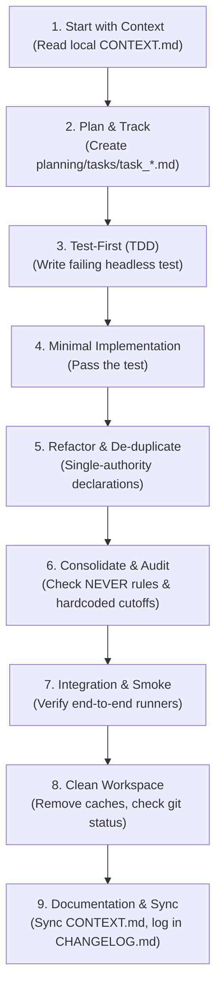

# The 9-Step Textbook Coding Pipeline

> The strict standard operating procedure for implementing features, modifying algorithms,
> and refactoring code in this repository. **Never skip these steps.**

---

## 1. Start with Context
- Read the local `CONTEXT.md` in the target directory before writing code.
- Consult `AGENTS.md` for project-level constraints and routing.
- If modifying an existing module, inspect existing tests and inputs.

## 2. Plan and Track
- Create or update a task tracking file under `planning/tasks/task_<name>.md`.
- Break down the goal into verifiable subtasks.
- Identify potential failure modes and trade-offs before touching code.

## 3. Test-First (TDD RED Phase)
- Write a headless unit test in `tests/` capturing the desired behavior.
- Run the test to confirm it fails for the expected reason (`RED`).
- Never integrate untested math, statistics, or data transformations.

## 4. Minimal Implementation (TDD GREEN Phase)
- Write the minimal, elegant implementation to make the test pass.
- Keep functions pure, typed, and modular.
- Expose all parameters in function signatures or configs.

## 5. Refactor & De-duplicate (TDD REFACTOR Phase)
- Ensure quantities, geometries, and constants are defined in exactly ONE authority file.
- Clean up intermediate variables, add docstrings, and ensure readability.

## 6. Consolidate & Audit
- Check against the `NEVER` rules in `AGENTS.md`.
- Confirm zero hardcoded analytical cutoffs, seeds, or thresholds.
- Verify error handling and edge cases (NaNs, empty inputs, zero division).

## 7. Integration & Verification
- Run the full test suite (`pytest`) on touched modules.
- Smoke-test upstream and downstream dependencies.

## 8. Clean the Workspace
- Remove all temporary scratch files, debug prints, and test outputs.
- Run `git status` to ensure zero untracked data arrays or intermediate caches exist.

## 9. Documentation & State Sync
- Update local `CONTEXT.md` if inputs, processes, or outputs changed.
- Sync `docs/CHANGELOG.md` when closing a milestone via `/project-checkpoint`.
- Keep the repository clean and interpretable for both humans and AI agents.
